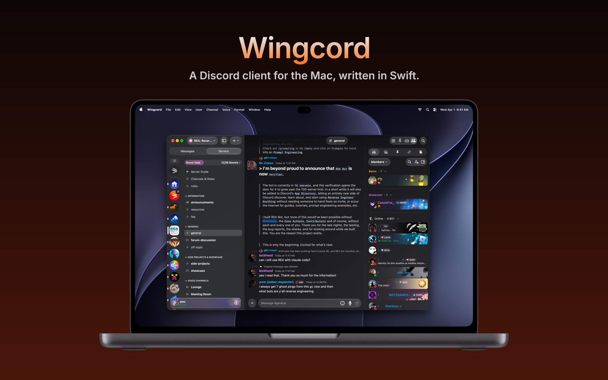

# Wingcord

Wingcord is a Discord client for the Mac, written in Swift for macOS 27. It's in beta.

[Download Wingcord](https://download.wingcord.app/Wingcord.dmg) · [Source code](https://github.com/WingcordApp/wingcord) · [Report a bug](https://github.com/WingcordApp/wingcord/issues)

The app's code is in [wingcord](https://github.com/WingcordApp/wingcord), licensed under the GNU General Public License, version 3 or later. Bug reports and feature ideas go to its issues. The easiest way to send one is from the app, with **Help > Report a Bug…** or **Help > Suggest a Feature…**, because the report includes the logs needed to look into it, and you can read everything in it before it's sent. To change the code yourself, start with [CONTRIBUTING.md](https://github.com/WingcordApp/wingcord/blob/main/CONTRIBUTING.md).

Please report security problems privately, as [SECURITY.md](https://github.com/WingcordApp/.github/blob/main/SECURITY.md) explains, and not in a public issue.

Discord Inc. doesn't make or endorse Wingcord.
